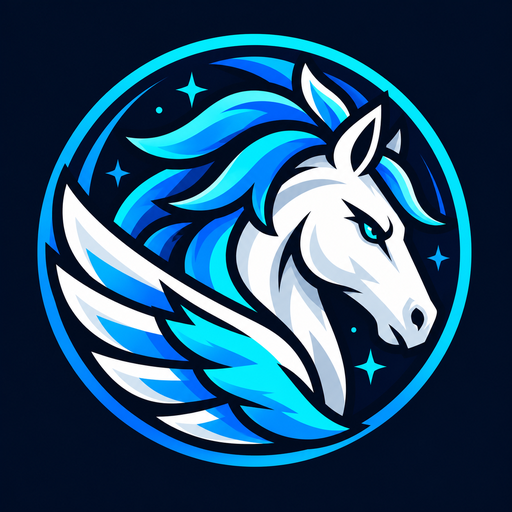

<div align="center">
  

  # PEGASUS

  **Palavras que ganham asas.**

  Mensagens, mídias e conversas privadas sob um céu inspirado na constelação de Pegasus.
</div>

---

## ✨ Pegasus v0.5 — o que mudou

A identidade visual do Pegasus foi refinada com base na logo escolhida para o projeto. Esta atualização preserva as funcionalidades da v0.4 e acrescenta:

- **Nova logo definitiva:** o emblema azul, ciano e branco com o rosto do cavalo alado sério, crina azul e asa na parte inferior. É exatamente a imagem selecionada, instalada no site como `public/pegasus-logo.png`, com favicon derivado da mesma imagem.
- **Fundo espacial redesenhado:** novo `pegasus-galaxy.svg`, com uma faixa de nebulosas azuladas e muitas estrelas, e `pegasus-constellation.svg`, um desenho estilizado da constelação com o quadrado de Pegasus e estrelas nomeadas.
- **Menu de mensagens por clique direito:** sem botões de três pontos. Funciona tanto em mensagens próprias quanto recebidas. Também pode ser aberto pelo teclado com `Shift + F10` e por toque prolongado em telas sensíveis ao toque.
- **Mensagem própria:** editar texto, copiar texto, salvar imagem ou apagar a mensagem para os dois participantes.
- **Mensagem recebida:** copiar texto, salvar imagem ou **apagar somente da própria visualização**, sem alterar a mensagem do remetente.
- **Transformação PG1 oculta da interface:** a conversa mostra apenas o texto interpretado; o usuário não vê mais um botão para inspecionar o código. A PG1 continua sendo utilizada internamente.
- **Sem etiqueta de versão no chat:** selo `BETA · 04` removido da interface.

**Observação:** a ocultação de códigos PG1 na tela não constitui criptografia de ponta a ponta (E2EE). A implementação mantém a transformação matemática PG1 e a criptografia AES-256-GCM para armazenamento no servidor; um cliente técnico pode estudar as requisições e o código-fonte.

## Funcionalidades

| Função | Disponível |
|---|:---:|
| Cadastro com e-mail e senha | ✅ |
| Foto, bio e código de contato de seis caracteres | ✅ |
| Iniciar conversa por código ou e-mail | ✅ |
| Permissão para novas conversas e solicitações | ✅ |
| Enviar e receber texto em tempo real | ✅ |
| Enviar imagens PNG, JPG, WEBP e GIF | ✅ |
| Editor de imagem (recorte, desenho, texto, filtros) | ✅ |
| Editar e apagar mensagens próprias sem aviso no chat | ✅ |
| Apagar mensagem recebida somente para si | ✅ |
| Contexto por botão direito para mensagens dos dois lados | ✅ |
| Áudio, vídeo e chamadas | Planejado |

## 🛠 Tecnologias

- **Node.js 22.13+** e servidor HTTP nativo
- **SQLite (`node:sqlite`)** para dados persistentes
- **Server-Sent Events (SSE)** para atualização de conversas
- **HTML, CSS e JavaScript** para a interface responsiva
- **Canvas API** para o editor de imagens
- **scrypt** para hashing de senhas
- **AES-256-GCM** para armazenamento cifrado de mensagens e mídias
- **PG1**, transformação reversível personalizada, apenas para mensagens de texto

## 📂 Estrutura

```text
Pegasus/
├── public/
│   ├── index.html
│   ├── styles.css
│   ├── app.js
│   ├── editor.js
│   ├── cipher.js
│   ├── pegasus-logo.png          # logo escolhida, usada no site
│   ├── favicon.png               # ícone do navegador
│   ├── pegasus-galaxy.svg        # nebulosas e estrelas
│   └── pegasus-constellation.svg # constelação estilizada
├── tests/
│   ├── cipher.test.mjs
│   ├── context-menu.test.mjs
│   ├── migration.test.mjs
│   ├── profile-privacy.test.mjs
│   └── server.test.mjs
├── server.mjs
├── package.json
├── .gitignore
└── README.md
```

## ▶️ Como executar

1. Instale o **Node.js 22.13.0 ou superior**.
2. Extraia este ZIP e abra a pasta `Pegasus` no terminal do VS Code.
3. Execute:

```bash
npm start
```

4. Abra **http://localhost:3000**.

Não é necessário instalar pacotes npm extras, pois o projeto utiliza módulos nativos do Node.js.

Para testar a troca de mensagens, crie duas contas em navegadores diferentes ou uma janela normal e outra anônima.

Para executar os testes:

```bash
npm test
```

## ♻️ Atualizar sem perder suas conversas

1. **Pare o servidor.**
2. Faça backup da pasta `data/`, principalmente `pegasus.sqlite`, `pegasus.sqlite-wal` (se existir), `pegasus.sqlite-shm` (se existir) e `local-secret.key`.
3. Substitua os arquivos do código pela v0.5 **sem apagar sua pasta `data/`**.
4. Inicie o servidor com `npm start`.

A v0.5 mantém a migração de usuários, perfis e solicitações anteriores, e cria apenas uma tabela adicional para mensagens ocultadas individualmente. Em um servidor remoto, mantenha a mesma variável `PEGASUS_MESSAGE_KEY` para conseguir decifrar o banco antigo.

## Segurança e limites atuais

O Pegasus é um **protótipo de desenvolvimento**, e não está pronto para implantação pública sem revisão de segurança e infraestrutura. As mensagens podem ser recuperadas pelo servidor: **não existe criptografia de ponta a ponta** nesta versão.

- Imagens estáticas: até **2,5 MB**; GIFs: até **4 MB**.
- Alterar ou apagar globalmente mensagens continua restrito ao **remetente**.
- Ao apagar uma mensagem recebida "só para mim", ela permanece acessível ao remetente e não reaparece no histórico da sua conta.
- Mensagens e imagens anteriores continuam no banco durante a atualização.
- Ainda faltam recuperação de senha, bloqueio de usuários, moderação/abuso, limites globais de armazenamento, confirmações de leitura e chamadas.

## 🗺️ Roadmap

- [x] v0.1 — Texto, cadastro e login
- [x] v0.2 — Envio de imagens
- [x] v0.3 — GIFs, editor, códigos e edição de mensagens
- [x] v0.4 — Foto de perfil, bio e aprovação de conversas
- [x] v0.5 — Logo aprovada, galáxia, contexto pelo botão direito e PG1 oculto
- [ ] Próximas versões — Áudio, respostas, notificações, vídeo e chamadas

## Commit para o GitHub

```bash
git add .
git commit -m "feat: atualiza logo Pegasus e melhora visual e ações das mensagens"
git push origin main
```

---

<div align="center"><strong>PEGASUS · Palavras que ganham asas.</strong></div>
